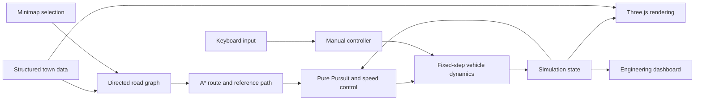
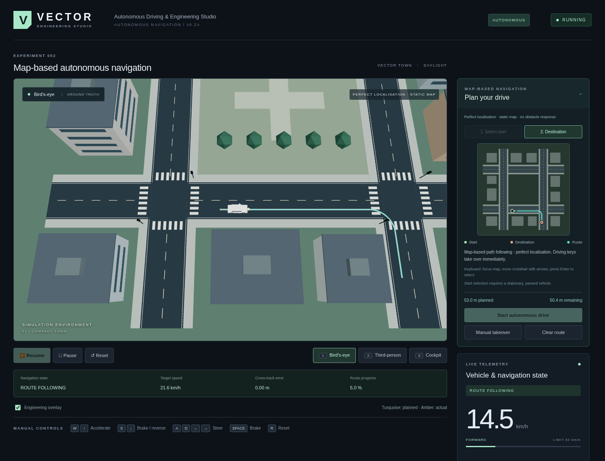

# VECTOR

**Autonomous Driving & Engineering Studio**

_Build the world. Sense the road. Navigate autonomously._


VECTOR is a lightweight, browser-based engineering laboratory for studying vehicle dynamics and the foundations of autonomous driving. **v0.2A — Autonomous Navigation Foundation** adds map-based autonomous path following with perfect localisation to the existing manual-driving simulator.

Select a start and destination on the offline minimap, preview the route, and watch the EV follow it through the town. The planned path, vehicle trajectory, and controller telemetry make the navigation calculations inspectable. This is a static-map engineering baseline, not a perception or real-world autonomous-driving system.

## Current capabilities

- Deterministic kinematic bicycle model with a fixed **0.01 s** integration step.
- Acceleration, braking, reverse, steering limits, and steering return to centre.
- Start/resume, pause, and deterministic reset.
- A geometry-built EV with steerable front wheels and rolling wheels.
- A compact town with four connected intersections, two-lane roads, crossings, sidewalks, buildings, and static traffic-light objects.
- Bird's-eye, third-person, and cockpit cameras sharing one 3D scene.
- Live model telemetry: speed, steering, acceleration, position, heading, and simulation time.
- Interactive SVG minimap using the same town data as the 3D scene.
- Directed lane graph, A* routing, and sampled road-aligned turns.
- Pure Pursuit steering, anticipatory corner-speed regulation, and destination stopping.
- Manual takeover, route reset/replanning, and optional controller overlays.
- Navigation state, target speed, remaining distance, cross-track error, look-ahead, and progress telemetry.
- Vitest checks for vehicle dynamics, routing, control, and deterministic navigation scenarios.

Sensors, obstacle avoidance, collision response, traffic-light behavior, moving traffic, and pedestrians remain outside v0.2A.

## Getting started on Windows

Install **Node.js 24 LTS** and Git, then use PowerShell. Node.js 22.12 or newer in the 22 release line is also supported by the tooling. A current browser with WebGL support is required; no WSL or backend is needed.

```powershell
git clone https://github.com/AsherFerdinand/VECTOR.git
cd VECTOR
# Until the milestone is merged, check out its feature branch:
git switch feat/vector-v0.2a-autonomous-navigation
npm ci
npm run dev
```

Open the address Vite prints in the terminal. Use **Start** for manual driving, or follow the navigation workflow below. Stop the server with `Ctrl+C`.

```powershell
npm test
npm run typecheck
npm run build
```

`npm ci` installs the exact dependency versions in `package-lock.json`. The production build is written to `dist/`; serve that directory with a static web server when deploying. Generated dependencies, build output, and coverage are ignored by Git.

## Plan an autonomous drive

1. Open **Plan your drive** in the navigation panel.
2. With the vehicle stationary and the simulation paused, select **Select start** and click a lane. The vehicle is placed on that lane with its travel-aligned heading. The existing start can also be used.
3. Select **Destination** and click a reachable lane. Review the turquoise route preview.
4. Select **Start autonomous drive**. The controller follows the route, slows for curves, and stops near the selected destination.
5. Use **Pause**, **Reset**, or **Manual takeover** as needed. A driving key also disengages autonomous control immediately.

Destination selection requires a paused simulation and never teleports the vehicle. Reset restores the selected start, pauses in manual mode, and recalculates the retained destination. Start selection is unavailable while moving, including when a moving vehicle has merely been paused: brake to rest or reset first.

Clicks on buildings, grass, curved turns, and ambiguous intersection centres are rejected. Lane direction matters: endpoints are dead ends, U-turns are unsupported, and some destinations are unreachable. The map can also be focused and operated with arrow keys and Enter.

## Controls

| Input     | Action                                                           |
| --------- | ---------------------------------------------------------------- |
| W / Up    | Accelerate forward; brake while reversing                        |
| S / Down  | Brake while moving forward; accelerate in reverse after stopping |
| A / Left  | Steer left                                                       |
| D / Right | Steer right                                                      |
| Space     | Strong braking to rest                                           |
| R         | Reset the simulation                                             |
| 1         | Bird's-eye camera                                                |
| 2         | Third-person camera                                              |
| 3         | Cockpit camera                                                   |

Use the visible buttons to start/resume, pause, reset, select a camera, or switch driving mode. During autonomous driving, W/A/S/D, driving arrows, or Space transfer command authority to the manual controller; the vehicle is not teleported or instantly stopped. Steering is rate limited and returns to centre when released. Braking opposes motion; it does not instantly change direction. See the [engineering model](docs/engineering-model.md) for the exact control rules.

## Architecture



Navigation, control, and simulation use plain TypeScript without React or Three.js dependencies. Minimap selections are projected onto directed lanes. A* finds connected road segments; a sampled reference path drives Pure Pursuit steering and a curvature-aware speed controller. Manual and autonomous modes feed the same bicycle model at 100 Hz. Rendering and telemetry read the resulting state; camera selection changes only the view. A* runs when a route is requested or reset, not every frame.

| Location                    | Responsibility                                                               |
| --------------------------- | ---------------------------------------------------------------------------- |
| `src/simulation/`           | Interfaces, bicycle equations, controller, and fixed-step clock              |
| `src/navigation/`           | Directed lanes, intersection connections, projection, A*, and route geometry |
| `src/autonomy/`             | Pure Pursuit, speed control, and navigation state                            |
| `src/controls/`             | Browser keyboard input                                                       |
| `src/world/`                | Structured town layout shared by road geometry                               |
| `src/rendering/`            | EV, town, lighting, and cameras                                              |
| `src/components/`           | Engineering telemetry UI                                                     |
| `src/App.tsx`               | Application lifecycle and simulation controls                                |
| `tests/`                    | Engineering behavior tests                                                   |
| `docs/engineering-model.md` | Equations, units, integration, and assumptions                               |

The controller receives static route data and perfect vehicle localisation. It does not receive dynamic perception or hidden future-world information. See [Navigation model and validation](docs/navigation-model.md) for graph construction, equations, tuning, states, and engineering results. Simulator ground truth and future sensor observations must remain distinct.

## Vehicle dynamics

The vehicle uses a rear-axle kinematic bicycle model:

```text
x_dot   = v cos(heading)
y_dot   = v sin(heading)
yaw_dot = (v / wheelbase) tan(steering)
v_dot   = acceleration
```

Position is measured in metres, velocity in m/s, and angles in radians. Explicit Euler integration advances the state at 100 Hz. The initial vehicle is 4.5 m long, 1.8 m wide, with a 2.7 m wheelbase. Limits are ±30° steering, 3 m/s² propulsion, 6 m/s² braking, 50 km/h forward speed, and 10 km/h reverse speed.

Read [Engineering model](docs/engineering-model.md) for the coordinate mapping, numerical method, control rules, timing policy, and limitations.

## Long-term vision

Beyond the implemented map-based navigation baseline, planned investigations include virtual LiDAR, camera, GNSS, IMU, and wheel sensors; object-detection visualization; safe-distance calculations; and explanations derived from actual driving decisions. A scenario editor and reproducible experiments will support evaluation of these features. They are planned capabilities, not operational features of v0.2A.

## Roadmap

| Version | Milestone                                             |
| ------- | ----------------------------------------------------- |
| v0.1    | Simulation Foundation                                 |
| v0.2A   | Autonomous Navigation Foundation — current            |
| v0.2B   | Navigation robustness and broader scenario validation |
| v0.3    | Virtual Sensors and Object Detection                  |
| v0.4    | Behaviour Planning and Decision Inspector             |
| v0.5    | Fault Injection and Engineering Validation            |
| v0.6    | Localisation and Sensor Fusion                        |
| v0.7    | Advanced Autonomous-Driving Investigations            |

## Engineering limitations

The bicycle model assumes a flat plane and ideal rolling without lateral tyre slip. It omits tyre forces, mass dynamics, suspension, load transfer, aerodynamic drag, powertrain behavior, collisions, and road-boundary enforcement. Buildings and traffic lights are visual objects. Maximum speed and steering are software bounds, not a validated handling envelope. Navigation uses perfect localisation, static geometry, and conservative controller tuning. Its reference path stays on the road network, but there is no collision engine or swept-body clearance guarantee. Tracking can deviate from the reference path. Traffic lights are ignored; no dynamic obstacle or pedestrian response is implemented.

Fixed-step determinism applies to identical initial conditions and identical simulation-step input sequences. Real keyboard timing and discarded wall time during slow frames can change a manual run. Browser rendering speed depends on the device; no Windows laptop FPS benchmark is claimed. The scene avoids external assets, post-processing, and expensive shadows.

VECTOR is an educational simulation environment. It does not demonstrate real-world autonomous-driving safety or claim AUTOSAR compliance.

## Screenshots



Actual v0.2A application capture from the cloud Chromium verification run. Driving GIFs can be added after capture.

## Verification

**56 automated tests pass**, including all 20 unchanged v0.1 tests. TypeScript checks and the production build pass. Tests cover graph connectivity and geometry, lane direction, A*, Pure Pursuit, speed control, route completion, deterministic replay, manual takeover, pause, and reset. See [navigation validation](docs/navigation-model.md#engineering-validation) for the predefined thresholds and measured results.

Chromium verification passed invalid-selection feedback, start-pose selection, destination selection without teleporting, route preview, autonomous completion of a 90° turn, pause/resume/reset, short-keypress manual takeover, manual steering, camera switching, and responsive mobile layout. The 3D scene, SVG minimap, and telemetry were exercised together.

These browser checks verify functionality, not Windows GPU performance. Windows execution and the 30–60 FPS target remain unverified. The production JavaScript bundle is approximately 330 kB gzip, mostly the 3D runtime; Vite reports its standard chunk-size warning.
