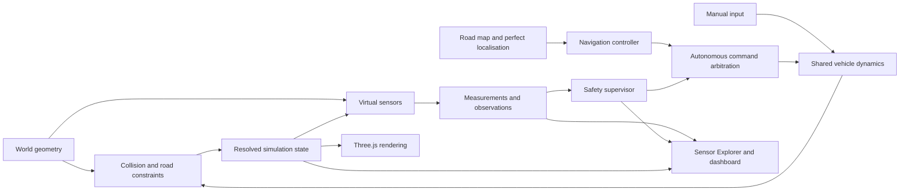
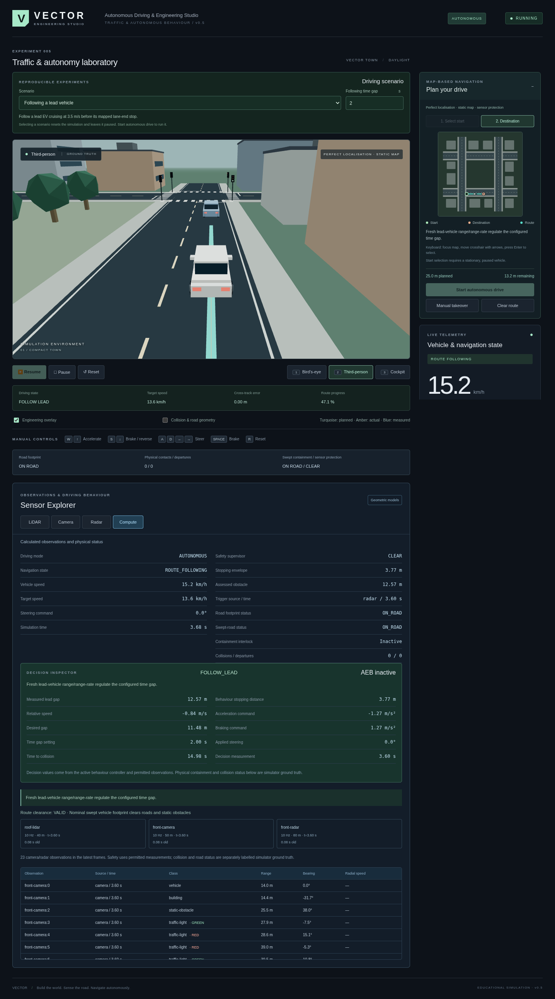

# VECTOR

**Autonomous Driving & Engineering Studio**

_Build the world. Sense the road. Navigate autonomously._


VECTOR is a lightweight, browser-based engineering laboratory for studying vehicle dynamics and the foundations of autonomous driving. **v0.6–v0.8 — Tracking, Corridor Planning and Validation** adds multi-sensor surface tracking, bounded lane-change/overtaking experiments, and seeded scenario analytics with recorded-state replay. Existing town driving, swept-body containment and observation-based ACC/AEB are preserved.

Select a route, drive manually or autonomously, and inspect the vehicle model, collision geometry, sensor measurements, and protective-braking calculations. Navigation still assumes a static road map and perfect localisation. Perception is generated by explicitly simplified geometric sensor models; it is not neural-network vision or a real-world autonomous-driving system.

## Current capabilities

- Deterministic kinematic bicycle model with a fixed **0.01 s** integration step.
- Acceleration, braking, reverse, steering limits, and steering return to centre.
- Start/resume, pause, and deterministic reset.
- A geometry-built EV with steerable front wheels and rolling wheels.
- A compact town with four connected intersections, two-lane roads, crossings, sidewalks, buildings, functional traffic lights, stop lines, and pedestrian crossings.
- Bird's-eye, third-person, and cockpit cameras sharing one 3D scene.
- Live model telemetry: speed, steering, acceleration, position, heading, and simulation time.
- Interactive SVG minimap using the same town data as the 3D scene.
- Directed lane graph, A* routing, and sampled road-aligned turns.
- Pure Pursuit steering, anticipatory corner-speed regulation, and destination stopping.
- Manual takeover, route reset/replanning, and optional controller overlays.
- Navigation state, target speed, remaining distance, cross-track error, look-ahead, and progress telemetry.
- Oriented vehicle-footprint collisions with aligned static obstacles, swept motion checks, and stop-at-contact response.
- Footprint-based road-departure classification and static route-clearance checks.
- Configurable 2D LiDAR, synthetic camera detections, and simplified radar measurements on simulation-time schedules.
- **LiDAR / Camera / Radar / Compute** Sensor Explorer tabs and optional engineering overlays.
- Six resettable scenarios: normal traffic, following, sudden lead braking, red light, pedestrian crossing, and blocked road.
- Camera/radar-associated lead selection, configurable following time gap, and bounded ACC commands.
- Observation-based AEB with TTC, sensor-age allowance, and emergency command priority.
- Observed red/yellow/green handling, pedestrian yielding, and fresh-clear automatic resumption.
- Actual swept-body containment checks; corrected intersection tracking without position corrections.
- Static-map rerouting only over a fully validated directed alternative; otherwise route rejection.
- Explainable Compute values for state, reason, gaps, TTC, commands, and physical status.
- Vitest checks for vehicle dynamics, routing, collision geometry, sensors, safety, and deterministic integration.

### Tracking, planning and validation workspaces

- **Drive:** existing 3D town, GPS and manual/autonomous controls. Qualified confirmed fused tracks regulate ACC; raw observations retain emergency safety priority and explicit degraded fallback.
- **Perception:** LiDAR/Camera/Radar plus constant-velocity Kalman surface tracks, estimated velocity, positional covariance ellipses, lifecycle and sensor contribution ages. Association uses statistical gates, never simulator IDs.
- **Compute:** live ACC/AEB explanations and a separate, explicitly mapped four-lane corridor experiment. Run a lane change or overtake-and-return through the real sensor → tracking → planning → bicycle-model loop; inspect rejected trajectories and replay the recording.
- **Validate:** configurable seeds, time gaps and radar noise; isolated deterministic scenarios, bounded batches, pass/fail criteria, metrics, recorded playback/seek, validation-only truth overlays, A/B baselines and JSON/CSV/text report downloads. Initial conditions and destinations are also configurable through the runner API.

The original town remains one lane per direction. Corridor manoeuvres are separate experiments, not connected town routes or general urban passing. Tracks estimate visible surfaces rather than complete object bodies; different faces can produce separate tracks. Tracking position metrics measure distance to the truth polygon boundary; covariance calibration is unavailable without corresponding scattering-point truth. Localisation remains perfect. Learned perception, general dynamic rerouting and arbitrary user-authored actor scripts remain outside this milestone.

See [current engineering notes](docs/v0.6-v0.8-engineering.md) for measured results, acceptance limits and remaining work. Earlier milestone measurements below are historical.

## Getting started on Windows

Install **Node.js 24 LTS** and Git, then use PowerShell. Node.js 22.12 or newer in the 22 release line is also supported by the tooling. A current browser with WebGL support is required; no WSL or backend is needed.

```powershell
git clone https://github.com/AsherFerdinand/VECTOR.git
cd VECTOR
# Until the milestone is merged, check out its feature branch:
git switch feat/vector-v0.6-v0.8-autonomy-validation
npm ci
npm run dev
```

Open the address Vite prints in the terminal. Use **Start** for manual driving, or follow the navigation workflow below. Stop the server with `Ctrl+C`.

```powershell
npm test
npm run typecheck
npm run build
```

`npm ci` installs the exact dependency versions in `package-lock.json`. The production build is written to `dist/`; serve that directory with a static web server when deploying. Generated dependencies, build output, and coverage are ignored by Git.

## Run a traffic experiment

Select one of the six **Driving scenario** presets. Selection resets simulation time, actor scripts, signals, sensors, and the ego vehicle, and leaves the application paused with a route preview. Choose **Start autonomous drive**. Following scenarios use short destinations behind the lead vehicle; red-light and pedestrian presets cross the eastern junction. The blocked preset rejects its infeasible route rather than driving through the obstacle.

Adjust **Following time gap** between 1 and 3 seconds. Sensor Explorer's **Compute** tab displays the measured lead gap, relative speed, desired gap, TTC, AEB state, and actual command reason. A driving key or **Manual takeover** restores manual authority. Reset reproduces the selected experiment. Traffic actors use bounded scripts and stop at their mapped endpoints; this is not an unlimited city-traffic simulation.

## Plan an autonomous drive

1. Open **Plan your drive** in the navigation panel.
2. With the vehicle stationary and the simulation paused, select **Select start** and click a lane. The vehicle is placed on that lane with its travel-aligned heading. The existing start can also be used.
3. Select **Destination** and click a reachable lane. Review the turquoise route preview.
4. Select **Start autonomous drive**. The controller follows the route, slows for curves, and stops near the selected destination.
5. Use **Pause**, **Reset**, or **Manual takeover** as needed. A driving key also disengages autonomous control immediately.

Destination selection requires a paused simulation and never teleports the vehicle. Reset restores the selected start, pauses in manual mode, and recalculates the retained destination. Start selection is unavailable while moving, including when a moving vehicle has merely been paused: brake to rest or reset first.

Clicks on buildings, grass, curved turns, and ambiguous intersection centres are rejected. Lane direction matters: endpoints are dead ends, U-turns are unsupported, and some destinations are unreachable. The map can also be focused and operated with arrow keys and Enter.

## Inspect collision and sensor behavior

Open **Sensor Explorer** and switch between **LiDAR**, **Camera**, **Radar**, and **Compute** while driving. The tabs expose measured ranges, synthetic detections, radial velocity, sensor timestamps, navigation state, and the limited safety supervisor's actual outputs. The camera tab pairs a forward-facing rendered image with geometric detections; it does not claim image-based object recognition.

Use the optional overlays to investigate collision footprints, road boundaries, or the selected sensor. Collision stops apply to solid geometry in either driving mode. Road departure is classified and counted without making every road edge a physical wall. Manual driving can leave the road and reverse away from contact when geometry allows.

Static route-clearance validation checks the full vehicle body plus a margin before activation. A rejected route reports its geometric reason. Autonomous protective braking separately uses observations of the immediate driving corridor; it does not treat every nearby roadside building as a threat. Unavailable or stale perception invokes a conservative autonomous stop. This is an educational protective layer, not production AEB.

Read [Collision and virtual sensors](docs/collision-sensors.md) for the sensor baseline and [Traffic and autonomy](docs/traffic-autonomy.md) for current control, scenario, and validation details.

## Controls

| Input     | Action                                                           |
| --------- | ---------------------------------------------------------------- |
| W / Up    | Accelerate forward; brake while reversing                        |
| S / Down  | Brake while moving forward; accelerate in reverse after stopping |
| A / Left  | Steer left                                                       |
| D / Right | Steer right                                                      |
| Space     | Strong braking to rest                                           |
| R         | Reset the simulation                                             |
| 1         | Bird's-eye camera                                                |
| 2         | Third-person camera                                              |
| 3         | Cockpit camera                                                   |

Use the visible buttons to start/resume, pause, reset, select a camera, or switch driving mode. During autonomous driving, W/A/S/D, driving arrows, or Space transfer command authority to the manual controller; the vehicle is not teleported or instantly stopped. Steering is rate limited and returns to centre when released. Braking opposes motion; it does not instantly change direction. See the [engineering model](docs/engineering-model.md) for the exact control rules.

## Architecture



Collision geometry, virtual sensors, navigation, and control use plain TypeScript without React or Three.js dependencies. Exact geometry belongs to the simulator's physical constraints and synthetic measurement generators. The autonomous safety supervisor receives sensor observations and localisation, not obstacle polygons or hidden world state. Static route-clearance checks are a simulator/map validation step, separate from online protective braking.

Both driving modes feed the same bicycle model at 100 Hz. Sensors use their configured simulation-time update rates rather than rendering FPS. Rendering and telemetry consume results; camera and sensor-tab selection do not alter physical motion. A* runs only when a route is requested or reset.

| Location                    | Responsibility                                                               |
| --------------------------- | ---------------------------------------------------------------------------- |
| `src/simulation/`           | Interfaces, bicycle equations, controller, and fixed-step clock              |
| `src/navigation/`           | Directed lanes, intersection connections, projection, A*, and route geometry |
| `src/autonomy/`             | Pure Pursuit, speed control, command arbitration, and sensor-based safety    |
| `src/sensors/`              | Configurations, raycasting, visibility, radar, and deterministic scheduling  |
| `src/controls/`             | Browser keyboard input                                                       |
| `src/world/`                | Structured town layout shared by road geometry                               |
| `src/rendering/`            | EV, town, lighting, and cameras                                              |
| `src/components/`           | Engineering telemetry UI                                                     |
| `src/App.tsx`               | Application lifecycle and simulation controls                                |
| `tests/`                    | Engineering behavior tests                                                   |
| `docs/engineering-model.md` | Equations, units, integration, and assumptions                               |

The [navigation model](docs/navigation-model.md) records the original v0.2A collision-free baseline and its controller validation. The [collision and sensor model](docs/collision-sensors.md) describes the current physical constraints, synthetic measurements, protective braking, and their limitations. Simulator ground truth, raw measurements, and processed detections remain distinct.

## Vehicle dynamics

The vehicle uses a rear-axle kinematic bicycle model:

```text
x_dot   = v cos(heading)
y_dot   = v sin(heading)
yaw_dot = (v / wheelbase) tan(steering)
v_dot   = acceleration
```

Position is measured in metres, velocity in m/s, and angles in radians. Explicit Euler integration advances the state at 100 Hz. The initial vehicle is 4.5 m long, 1.8 m wide, with a 2.7 m wheelbase. Limits are ±30° steering, 3 m/s² propulsion, 6 m/s² braking, 50 km/h forward speed, and 10 km/h reverse speed.

Read [Engineering model](docs/engineering-model.md) for the coordinate mapping, numerical method, control rules, timing policy, and limitations.

## Long-term vision

Beyond the implemented collision and geometric-sensor baseline, planned investigations include GNSS, IMU, and wheel sensors; sensor noise and fault experiments; localisation and sensor fusion; richer traffic interactions; and more detailed explanations derived from actual planning decisions. A scenario editor and reproducible experiments will support evaluation of these features. They are planned capabilities, not operational features of this milestone.

## Roadmap

| Version | Milestone                                                            |
| ------- | -------------------------------------------------------------------- |
| v0.1    | Simulation Foundation                                                |
| v0.2A   | Autonomous Navigation Foundation                                     |
| v0.2B   | Collision Detection, Road Boundaries & Route Clearance — implemented |
| v0.3    | Virtual Sensors, Perception & Sensor Explorer — implemented          |
| v0.3.1  | Actual Swept-Body Road Containment — implemented                     |
| v0.4    | Dynamic Traffic and Reproducible Scenarios — implemented             |
| v0.5    | ACC, AEB, Traffic Response and Explainable Compute — current         |
| v0.6    | Localisation and Sensor Fusion                                       |
| v0.7    | Advanced Autonomous-Driving Investigations                           |

## Engineering limitations

The bicycle model assumes a flat plane and ideal rolling without lateral tyre slip. It omits tyre-force dynamics, suspension, load transfer, aerodynamic drag, grade, and energy consumption. Collision response stops at contact without crash deformation, impulses, or bouncing. Swept collision, road coverage, sensor visibility, and route clearance use documented numerical approximations.

Navigation retains perfect localisation and static road geometry. Virtual LiDAR is 2D geometric raycasting; camera detections are synthetic visibility observations; radar uses simplified geometry and relative motion. They do not model optical or electromagnetic propagation, a neural detector, or full 3D occlusion. Traffic vehicles and pedestrians come from the selected deterministic scenario. Camera signal colours are available only when geometrically visible. Radar remains range/bearing/range-rate sensing; camera semantics are associated with nearby radar measurements, without simulator IDs or hidden actor state.

Protective braking is limited to sensed obstacles in an approximate immediate path corridor. It is not a guarantee against collision, and it does not override manual driving. Static route validation does not perform advanced obstacle rerouting. The former intersection departures are fixed in the validated routes. Runtime swept-footprint validation stops an infeasible autonomous command rather than projecting the vehicle back onto the road. Passing the tested scenarios is not a guarantee for arbitrary manually displaced initial conditions.

Fixed-step determinism applies to identical initial conditions and identical simulation-step input sequences. Real keyboard timing and discarded wall time during slow frames can change a manual run. Browser rendering speed depends on the device; no Windows laptop FPS benchmark is claimed. The scene avoids external assets, post-processing, and expensive shadows.

VECTOR is an educational simulation environment. It does not demonstrate real-world autonomous-driving safety or claim AUTOSAR compliance.

## Screenshots



Genuine Chromium capture. Historical [v0.3](docs/screenshots/vector-v0.3.png) and [v0.2A](docs/screenshots/vector-v0.2a.png) captures remain available.

## Verification

Run `npm test`, `npm run typecheck`, and `npm run build`. **186 tests pass**, including all 110 unchanged baseline tests. TypeScript checks and production build pass. New numerical tests cover rotated turn containment, moving collisions, measured traffic responses, scenario replay, and clearance-validated alternative routes. See [Traffic and autonomy](docs/traffic-autonomy.md) for measured results and limitations.

The scripted production scenarios complete or reject as expected without collisions, road departures, or containment-interlock activation. Windows hardware FPS remains unverified. Vite retains its large-chunk warning; JavaScript is approximately 351 kB gzip. No dependencies were added.

Production Chromium checks passed for all six scenario presets, following-gap input, signal/pedestrian stop and resumption, moving camera imagery, LiDAR/Radar, overlays, manual takeover, pause/reset, camera modes and mobile layout, with no page or console errors. The screenshot above is from that run.
