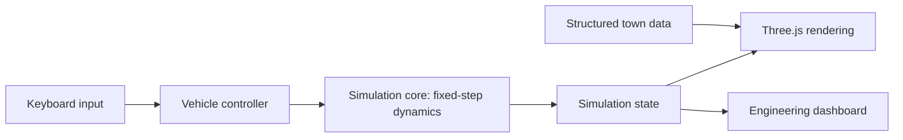
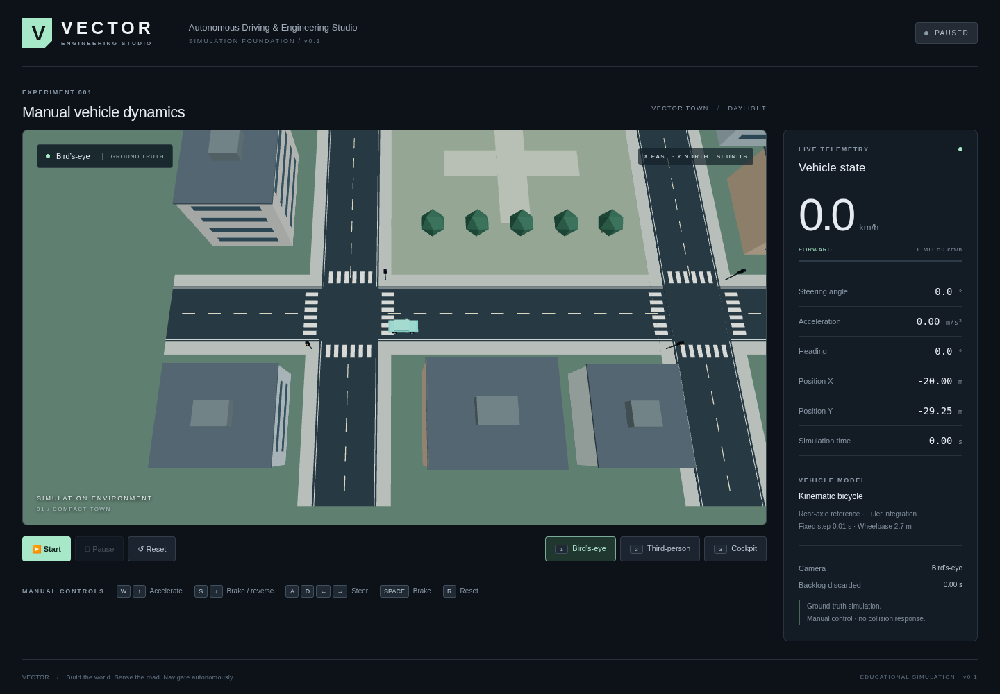

# VECTOR

**Autonomous Driving & Engineering Studio**

_Build the world. Sense the road. Navigate autonomously._


VECTOR is a lightweight, browser-based engineering laboratory for studying vehicle dynamics and the foundations of autonomous driving. **v0.1 — Simulation Foundation** establishes a manually driven vehicle, a reproducible simulation core, and an inspectable 3D environment.

The long-term goal is to connect virtual environments, autonomous-driving architecture, engineering transparency, and scenario-based validation. This milestone provides the simulation ground truth on which those investigations can build.

## Current capabilities

- Deterministic kinematic bicycle model with a fixed **0.01 s** integration step.
- Acceleration, braking, reverse, steering limits, and steering return to centre.
- Start/resume, pause, and deterministic reset.
- A geometry-built EV with steerable front wheels and rolling wheels.
- A compact town with four connected intersections, two-lane roads, crossings, sidewalks, buildings, and static traffic-light objects.
- Bird's-eye, third-person, and cockpit cameras sharing one 3D scene.
- Live model telemetry: speed, steering, acceleration, position, heading, and simulation time.
- Vitest checks for vehicle dynamics, controls, timing, and reset behavior.

Autonomous navigation, sensors, collision response, moving traffic, and pedestrians are outside v0.1.

## Getting started on Windows

Install **Node.js 24 LTS** and Git, then use PowerShell. Node.js 22.12 or newer in the 22 release line is also supported by the tooling. A current browser with WebGL support is required; no WSL or backend is needed.

```powershell
git clone https://github.com/AsherFerdinand/VECTOR.git
cd VECTOR
# Until the foundation is merged, check out its feature branch:
git switch feat/vector-v0.1-foundation
npm ci
npm run dev
```

Open the address Vite prints in the terminal. Click **Start** and use the controls below. Stop the server with `Ctrl+C`.

```powershell
npm test
npm run typecheck
npm run build
```

`npm ci` installs the exact dependency versions in `package-lock.json`. The production build is written to `dist/`; serve that directory with a static web server when deploying. Generated dependencies, build output, and coverage are ignored by Git.

## Controls

| Input     | Action                                                           |
| --------- | ---------------------------------------------------------------- |
| W / Up    | Accelerate forward; brake while reversing                        |
| S / Down  | Brake while moving forward; accelerate in reverse after stopping |
| A / Left  | Steer left                                                       |
| D / Right | Steer right                                                      |
| Space     | Strong braking to rest                                           |
| R         | Reset the simulation                                             |
| 1         | Bird's-eye camera                                                |
| 2         | Third-person camera                                              |
| 3         | Cockpit camera                                                   |

Use the visible buttons to start/resume, pause, reset, or select a camera. Steering is rate limited and returns to centre when released. Braking opposes motion; it does not instantly change direction. See the [engineering model](docs/engineering-model.md) for the exact control rules.

## Architecture



The simulation core uses plain TypeScript and has no React or Three.js dependencies. Keyboard state becomes bounded steering and acceleration commands; the dynamics integrate those commands into vehicle state. Rendering reads this state to position the vehicle and animate its wheels. The dashboard reads the same state and converts SI values to display units. Camera selection changes only the view.

| Location                    | Responsibility                                                  |
| --------------------------- | --------------------------------------------------------------- |
| `src/simulation/`           | Interfaces, bicycle equations, controller, and fixed-step clock |
| `src/controls/`             | Browser keyboard input                                          |
| `src/world/`                | Structured town layout shared by road geometry                  |
| `src/rendering/`            | EV, town, lighting, and cameras                                 |
| `src/components/`           | Engineering telemetry UI                                        |
| `src/App.tsx`               | Application lifecycle and simulation controls                   |
| `tests/`                    | Engineering behavior tests                                      |
| `docs/engineering-model.md` | Equations, units, integration, and assumptions                  |

An autonomous-driving stack can later supply control inputs without moving physical calculations into rendering. Simulator ground truth and future sensor observations must remain distinct.

## Vehicle dynamics

The vehicle uses a rear-axle kinematic bicycle model:

```text
x_dot   = v cos(heading)
y_dot   = v sin(heading)
yaw_dot = (v / wheelbase) tan(steering)
v_dot   = acceleration
```

Position is measured in metres, velocity in m/s, and angles in radians. Explicit Euler integration advances the state at 100 Hz. The initial vehicle is 4.5 m long, 1.8 m wide, with a 2.7 m wheelbase. Limits are ±30° steering, 3 m/s² propulsion, 6 m/s² braking, 50 km/h forward speed, and 10 km/h reverse speed.

Read [Engineering model](docs/engineering-model.md) for the coordinate mapping, numerical method, control rules, timing policy, and limitations.

## Long-term vision

Planned investigations include an interactive GPS minimap and autonomous navigation; virtual LiDAR, camera, GNSS, IMU, and wheel sensors; object-detection visualization; safe-distance calculations; and explanations derived from actual driving decisions. A scenario editor and reproducible experiments will support evaluation of these features. They are planned capabilities, not operational features of v0.1.

## Roadmap

| Version | Milestone                                      |
| ------- | ---------------------------------------------- |
| v0.1    | Simulation Foundation                          |
| v0.2    | Interactive GPS and Autonomous Route Following |
| v0.3    | Virtual Sensors and Object Detection           |
| v0.4    | Behaviour Planning and Decision Inspector      |
| v0.5    | Fault Injection and Engineering Validation     |
| v0.6    | Localisation and Sensor Fusion                 |
| v0.7    | Advanced Autonomous-Driving Investigations     |

## Engineering limitations

The bicycle model assumes a flat plane and ideal rolling without lateral tyre slip. It omits tyre forces, mass dynamics, suspension, load transfer, aerodynamic drag, powertrain behavior, collisions, and road-boundary enforcement. Buildings and traffic lights are visual objects. Maximum speed and steering are software bounds, not a validated handling envelope.

Fixed-step determinism applies to identical initial conditions and identical simulation-step input sequences. Real keyboard timing and discarded wall time during slow frames can change a manual run. Browser rendering speed depends on the device; no Windows laptop FPS benchmark is claimed. The scene avoids external assets, post-processing, and expensive shadows.

VECTOR is an educational simulation environment. It does not demonstrate real-world autonomous-driving safety or claim AUTOSAR compliance.

## Screenshots



Actual application capture from the cloud Chromium validation run. Driving GIFs can be added after capture.

## Verification

The v0.1 validation run passed 20 Vitest tests, TypeScript checking, and a production build. Headless Chromium with software WebGL verified startup, acceleration, steering-induced yaw, reverse, Space braking, all three camera selections, pause, reset, and responsive resizing (1440 × 1000 to 390 × 844), without JavaScript page errors.

These browser checks verify functionality, not Windows GPU performance. Windows execution and the 30–60 FPS target remain unverified. The production JavaScript bundle is approximately 1.14 MB (321 kB gzip), mostly the 3D runtime; Vite reports its standard chunk-size warning.
