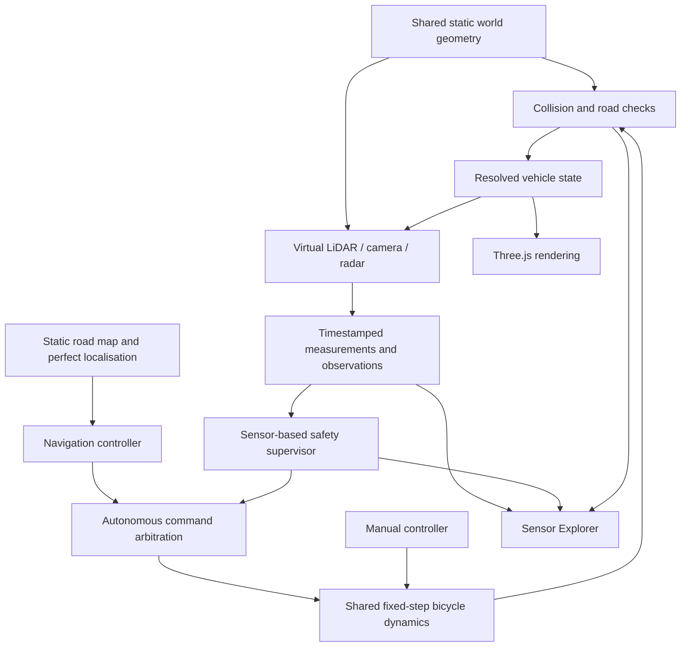

# Collision engineering and virtual perception — v0.2B + v0.3

This milestone adds physical static-obstacle constraints and simplified sensor observations to VECTOR's existing navigation baseline. The [vehicle model](engineering-model.md) and [v0.2A navigation model](navigation-model.md) remain useful references. Their milestone-specific limitations and measurements describe the earlier collision-free, sensor-free baseline; this document describes the added behavior.

## Information boundaries

Exact world geometry is **simulator ground truth**. It is available to collision resolution, static route-clearance validation, and virtual sensor generators because those modules simulate the physical environment. It is not an online obstacle oracle for autonomous safety.

Virtual sensors turn polygons and vehicle pose into timestamped measurements. The safety supervisor receives those observations and permitted localisation/path data. It does not receive world-object polygons. This preserves the distinction between a simulator preventing a body from penetrating a wall and a controller deciding to brake because a virtual measurement suggests a threat.



All geometry, measurement, control, and scheduling calculations are plain TypeScript. React and Three.js display their results.

## World and coordinate conventions

Simulation position is in metres on the `(x, y)` plane. Heading is counterclockwise from +x. A sensor mount uses vehicle-local `x` forward from the rear axle and `y` left. Sensor yaw is added to vehicle heading. A mount `(mx, my)` becomes:

```text
sensor_x = vehicle_x + cos(heading) mx - sin(heading) my
sensor_y = vehicle_y + sin(heading) mx + cos(heading) my
sensor_heading = vehicle_heading + sensor_yaw
```

Measurement bearing is relative to the sensor's forward axis; positive bearing points left. Relative positions use that same sensor-local frame. Scan points used by overlays are transformed into world coordinates. Rendering retains the existing mapping `(x, y) → (x, height, -y)`.

The current solid world contains 30 objects: 12 buildings, eight traffic-light poles, and ten tree trunks. Buildings come directly from `town.json`. Traffic-light pole and tree-trunk placements are shared with their rendered counterparts. The solid footprints are building rectangles, 0.13 × 0.13 m pole rectangles, and 0.4 × 0.4 m trunk rectangles. Roof overhangs, foliage, lens colors, road markings, and sidewalks are not automatically ground-level collision obstacles. The current world has no moving vehicles or pedestrians; no corresponding detections are fabricated.

## Vehicle footprint and contact

Vehicle state locates the **rear axle**, not the body centre. The 4.5 × 1.8 m rectangle is centred 1.35 m forward of that reference. In vehicle-local coordinates it extends from −0.9 to +3.6 m longitudinally and ±0.9 m laterally. Heading rotates this footprint into world coordinates. Collision geometry omits small visual mirrors and models a flat ground plane.

The collision engine uses Separating Axis Theorem tests for the convex polygons in this world. Exact touching is treated with a 1e−8 m contact tolerance to reduce numerical sticking. Broad-phase swept bounds discard distant static objects before detailed checks.

The proposed bicycle-model pose is not accepted directly. Conservative advancement checks the whole interval from the previous pose to the proposed pose, including rotation. Its boundary-motion bound is:

```text
boundary_travel ≤ translation_distance + abs(delta_heading) * body_radius
```

The radius bounds the farthest body corner from the rear axle. At each intermediate pose, polygon separation divided by that bound determines a conservative step, scaled by 0.8. This is not endpoint-only sampling: a thin obstacle crossed between valid endpoint poses is still considered. Contact is refined with up to 30 bisection iterations. A 256-iteration guard stops conservatively at the last safe pose if convergence is slow.

The response accepts a non-penetrating contact pose and sets longitudinal speed to zero. It does not model impulses, deformation, restitution, frictional sliding, or bouncing. A small separating motion from exact initial contact is permitted, so reversing away remains possible. This algorithm assumes a valid non-penetrating starting pose; it is not a general solver for arbitrary pre-existing interpenetration.

Collision events expose the simulation timestamp, obstacle debug identifier, resolved position, and cumulative count. Histories retain the latest 64 events. Repeated inward commands at the same contact do not create a new event every tick: contact is cleared after a separating move exceeds 0.05 m. A launch probe keeps velocity exactly zero on every held-throttle tick at contact, avoiding the explicit-Euler rest/acceleration alternation. A geometrically separating reverse launch remains available.

These are engineering ground-truth events, not sensor detections. Physical contact applies in both manual and autonomous modes. Autonomous physical contact separately inhibits further propulsion until explicit intervention; the UI labels it as collision-engine information rather than pretending it came from perception.

## Road status and route clearance

Road rectangles derive from the existing road endpoints and width. Polygon clipping computes coverage of the full oriented vehicle footprint by the **union** of those rectangles, including intersections:

| Status               | Meaning                                                                 |
| -------------------- | ----------------------------------------------------------------------- |
| `ON_ROAD`            | The vehicle footprint has no uncovered area beyond numerical tolerance. |
| `PARTIALLY_OFF_ROAD` | Some, but not all, footprint area lies outside the road union.          |
| `FULLY_OFF_ROAD`     | No footprint area lies on the road union beyond numerical tolerance.    |

Area comparisons use 1e−8 m² tolerance. A body centre on a road is insufficient to classify the vehicle as on-road. Departure events are counted separately from collisions. Each transition into a different off-road status increments the counter, so `ON_ROAD → PARTIALLY_OFF_ROAD → FULLY_OFF_ROAD` records two events. The latest 64 departure events retain simulation timestamps and positions. Grass and non-solid road edges do not become invisible physical walls.

Static route validation constructs full-body poses along the reference path, unwraps headings across ±π, and checks road coverage and solid-obstacle clearance. The configurable footprint margin defaults to **0.02 m**. Intermediate samples bound body-point travel to at most **0.04 m**; extra half-step footprint inflation covers motion between sampled poses. An invalid path reports a reason and distance along the route instead of silently activating autonomous motion.

This is nominal path preflight, not an advanced rerouting algorithm or a guarantee that a tracking controller never deviates from the reference. Runtime collision checks remain active. A route may be rejected for leaving pavement even when its centreline is on-road. In the current production navigation validation, both the right-turn and multiple-intersection runs pass nominal clearance but record one partial road-departure event due to tracking error. Neither collides. This known limitation is a warning about actual full-body containment, not a hidden collision or a claim that path preflight guarantees runtime road clearance.

## Measurement interfaces

`WorldObject` contains exact polygon geometry, a simulator identifier, class, height, velocity, and collidability. These objects stay inside the world/collision/sensor side of the information boundary.

A raw `LidarScan` contains sensor ID, acquisition timestamp, acquisition pose, range limit, and rays. Each ray reports sensor-relative angle, measured range, hit/miss status, and a world-space point. A miss reports maximum range; a hit does not expose an obstacle polygon.

Camera and radar emit `DetectionFrame` observations with acquisition pose and timestamp. A detection supplies measured relative position, range, bearing, and only the fields supported by that modality. Camera supplies a synthetic geometric class. Radar supplies radial velocity. Stable world IDs are exposed only as `debugObjectId` for UI inspection; they are not inferred tracking identity. Observation IDs enumerate a frame's measurements and are not a persistent object tracker. No confidence score is invented.

## Default sensor configuration

All mounts are measured from the rear axle in vehicle-local metres. Default yaw is zero and default measurement noise is zero; nonzero noise is opt-in configuration.

| Sensor | Mount `(forward, left)` | Horizontal FOV | Range | Rate  | Other settings      |
| ------ | ----------------------- | -------------- | ----- | ----- | ------------------- |
| LiDAR  | `(1.35, 0)` m           | 360°           | 40 m  | 10 Hz | 180 rays, seed 1001 |
| Camera | `(2.25, 0.35)` m        | 90°            | 50 m  | 10 Hz | Seed 1002           |
| Radar  | `(3.6, 0)` m            | 120°           | 80 m  | 10 Hz | Seed 1003           |

## Virtual LiDAR

The default model casts **180 horizontal rays over 360°, out to 40 m, at 10 Hz**. The nearest intersection with a relevant opaque polygon is retained for each ray. Nearer geometry occludes farther geometry along the same ray. An origin inside geometry produces zero range.

Optional bounded range noise affects hit ranges, then clamps them into `[0, maxRange]`; misses retain maximum range. This is a 2D geometric scan, not an optical or full 3D LiDAR model. Finite angular spacing can miss small objects between rays, and no reflectivity, beam divergence, vertical channels, multipath, or material transparency is modeled.

## Synthetic camera

The default camera has **90° horizontal FOV, 50 m range, and a 10 Hz observation rate**. A forward-facing rendered image is separate from the synthetic detection output. While the Camera tab is selected, a 320 × 180 pixel offscreen pass reuses the primary scene and WebGL context at each new camera observation. It uses that frame's acquisition pose, a 1.48 m mounting height, and the configured horizontal FOV converted to vertical FOV for the image aspect ratio. The ego body and debug overlays are hidden in this pass. The image freezes when simulation time is paused; it is not a second independently running world.

Geometric visibility samples polygon vertices, edge midpoints, nearest edge points, and centre/FOV-boundary rays. A candidate sample must be in range and FOV and its line of sight must hit that object first. One nearest visible surface observation is emitted per object. A fully hidden object is therefore excluded rather than reported merely because its centre lies in the view cone.

This is finite 2D visibility sampling. Narrow visible slivers can be missed; heights do not produce full 3D occlusion. The rendered image may contain details outside the ground-footprint observation model, such as foliage or roof overhangs. Labels and distances are synthetic geometry observations, not neural detections. A detection list/world-space highlighting is used instead of fabricated image bounding boxes.

## Simplified radar

The default radar has **120° horizontal FOV, 80 m range, and a 10 Hz update rate**. It uses geometric visibility to obtain one surface observation per visible object, rather than reproducing LiDAR rays.

Radial velocity is relative to the mounted sensor, including the mount's rotational velocity:

```text
sensor_velocity = vehicle_linear_velocity + yaw_rate × mount_offset
radial_velocity = dot(object_velocity - sensor_velocity, line_of_sight_unit_vector)
```

A negative value means closing range. A static object directly ahead of a vehicle moving toward it therefore has negative radial velocity; it is not reported as zero merely because the object is stationary. Object velocities are supported by the interface, although the current town is static.

Optional deterministic noise perturbs range, bearing, and radial velocity on separate channels. An amplitude `noise` bounds range perturbation to ±`noise` metres, velocity perturbation to ±`noise` m/s, and bearing perturbation to ±`noise / maxRange` radians. This model does not simulate electromagnetic propagation, radar cross-section, multipath, Doppler processing, or tracking. Camera-style line-of-sight occlusion is an explicit geometric simplification for this radar baseline.

## Noise, timing, and reproducibility

Sensor configuration includes identifier, modality, mount, yaw, FOV, range, update rate, optional ray count, noise amplitude, and seed. Noise is bounded uniform perturbation generated from the seed, acquisition timestamp, measurement index, and channel. It does not use wall-clock randomness.

Measurements run on simulation time, independently of rendering rate. Pausing stops acquisition time; reset restarts the seeded sequence and clears/recreates measurements consistently. Individual sensor update counts and acquisition timestamps are exposed in the Explorer so stale data can be distinguished from a newly rendered display.

The default sensors use 10 Hz acquisition on the existing 100 Hz physics clock, including an initial sample at time zero. Period indices are computed from simulation time. If an update jumps over several periods, the scheduler samples once with the actual current pose and timestamp; it drops missed periods instead of inventing past poses or running an unbounded catch-up loop. At 0.25 s, a normal 10 Hz run therefore has three frames at 0, 0.1, and 0.2 s. Outputs are cached immutable snapshots. Changing rendering FPS does not make them scan more often. The displayed camera image is a renderer output refreshed with new 10 Hz observation frames only while its tab is selected; image capture does not schedule sensor acquisition.

## Protective braking

The safety supervisor is an intentionally limited autonomous layer. It transforms sensed points from acquisition poses into the current vehicle frame using permitted perfect ego localisation. It does not read obstacle polygons or debug object identifiers.

Primary LiDAR must be present, nonempty, and no older than **0.30 s**. Missing, stale, or future-dated primary data produces `STALE_STOP`. Fresh camera and radar observations can add evidence of a threat, but cannot replace missing primary LiDAR. Manual mode reports `MANUAL` and returns control commands unchanged even with stale data or nearby measurements.

For speed `v ≥ 0`, the stopping envelope in metres is:

```text
d_stop = v² / (2 * 6) + v * (scan_age + lidar_period + 0.1) + 1
```

The terms represent the 6 m/s² maximum braking capability, observed scan age, one acquisition period, 0.1 s processing allowance, and 1 m stop margin. At 6 m/s with a new 10 Hz scan, `d_stop = 5.2 m`. This envelope is compared with estimated **body-contact travel**, not raw range from an arbitrary sensor mount.

The straight driving corridor includes the body extending 3.6 m forward and 0.9 m rearward from the rear axle, with a lateral half-width of `0.9 + 0.15 = 1.05 m`. For nonzero actual steering, constant-steering body poses are sampled every 0.25 m of travel. The earliest corridor overlap with a measured point estimates contact distance, adjusted conservatively for the sampling interval. Returns beside the road or behind the vehicle do not automatically become threats.

A threatening measurement produces `PROTECTIVE_BRAKING`, preserving the requested steering and applying up to 6 m/s² opposing acceleration, clipped to stop exactly at zero rather than reverse. `CLEAR` means no supplied fresh measurement intersects the stopping corridor; it does not mean the world is known to be obstacle free. The simulation latches a triggered autonomous stop until explicit reactivation, manual takeover, or reset so a shrinking braking envelope cannot cause stop-and-go creeping. The supervisor assessment itself is stateless.

Sensor-source timestamps, the triggering observation, stopping-distance estimate, and a concrete reason are exposed in the UI. Manual driving is not silently overridden by this supervisor. Simulator collision constraints still prevent solid-object penetration in manual mode.

This is not production AEB, obstacle avoidance, traffic negotiation, pedestrian prediction, or a collision-free guarantee. Its finite rays, simplified visibility, update delay, path approximation, and static-world assumptions limit what it can detect and how early it can react.

## Sensor Explorer and overlays

The **LiDAR** tab shows scan timestamp, return count, range, update rate, and scan geometry. **Camera** provides a forward-facing image and synthetic detections. **Radar** shows measured range, bearing, and radial velocity. **Compute** exposes sensor availability, actual observations, navigation commands, and safety state without fabricated AI reasoning.

Overlays are off by default. A sensor overlay shows only the currently selected LiDAR, camera, or radar source; a separate collision-debug option exposes physical geometry. Optional overlays separate physical ground truth from measurements: body/obstacle collision footprints and road boundaries are engineering geometry; LiDAR points and camera/radar observations are sensor outputs. Planned route remains turquoise, actual trajectory amber, sensor measurements blue, and contact or immediate hazard red. Tab and overlay switching do not advance or modify physics.

## Engineering validation

The automated suite preserves earlier vehicle/navigation checks and adds numerical tests for collision overlap, rotation, thin-obstacle sweeps, contact/reverse behavior, road-area classification, route clearance, LiDAR ranges and occlusion, camera visibility, radar relative motion, deterministic noise/timing, stale perception, and manual/autonomous command separation.

The collision and safety suites declare their numerical acceptance before evaluation: known contact-position error and penetration tolerance ≤1e−6 m; primary freshness ≤0.30 s; no autonomous-safety override in manual mode; and a physically feasible 6 m/s obstacle approach must stop at least 1 m before contact. Zero-noise sensor checks compare known geometric references; configured noise must remain within its explicit amplitude and replay exactly.

| Scenario / module-level check                              | Reference or acceptance                                                            | Measured result                                                                           |
| ---------------------------------------------------------- | ---------------------------------------------------------------------------------- | ----------------------------------------------------------------------------------------- |
| A — Building contact                                       | Actual building 0, contact-position tolerance 1e−6 m                               | Rear-axle x = −54.1 m; no penetration                                                     |
| B — High-speed sweep                                       | 100 m proposed translation across a 1 mm wall at x = 20 m                          | Resolved rear-axle x = 16.399999997 m; error 2.77e−9 m; final speed 0 m/s; no penetration |
| C — Road departure                                         | Full polygon coverage, including a concave intersection case                       | On-road, partial, and fully off-road classifications match expected geometry              |
| Static route clearance                                     | Original straight, right-turn, and multiple-intersection paths with default margin | All three nominal paths clear pavement and static solids                                  |
| D — LiDAR geometry                                         | Wall surface 10 m ahead, zero noise                                                | Range 10 m                                                                                |
| E — Camera occlusion                                       | One object fully hidden by a nearer opaque rectangle                               | Hidden object excluded; exposed neighboring object retained                               |
| F — Radar static relative motion                           | Ego 5 m/s toward static surface                                                    | Radial velocity −5 m/s                                                                    |
| F — Radar moving object                                    | Ego 5 m/s, object 2 m/s in the same direction                                      | Radial velocity −3 m/s                                                                    |
| Radar rotating mount                                       | Mount `(0, 1)` m, yaw rate 2 rad/s, object ahead                                   | Radial velocity +2 m/s                                                                    |
| Sensor scheduling                                          | 10 Hz over normal updates from 0 to 0.25 s                                         | Three frames per sensor, latest timestamp 0.2 s                                           |
| G — Protective braking, isolated repeated-measurement test | Stop ≥1 m before obstacle from 6 m/s                                               | Trigger gap 5.18 m; stopped gap 2.15 m; final speed 0 m/s                                 |

The isolated safety approach supplies fresh synthetic points on each physics tick to test the supervisor and braking mathematics. It is distinct from an end-to-end acquisition-rate test using the virtual sensor generators. The production integration results below use the real 10 Hz acquisition scheduler and are the relevant end-to-end comparison. Browser interaction and Windows hardware performance remain separate from headless mathematical tests; screenshots do not establish collision or sensor numerical correctness.

### Production integration and navigation regression

The complete run passed **110 tests**: 56 original vehicle/navigation tests, 13 collision tests, 17 sensor tests, 11 safety tests, five lateral-budget checks, and eight production integration tests. TypeScript checking and the production build passed.

| Integration scenario                          | Actual result                                                                                                                                                                                                      |
| --------------------------------------------- | ------------------------------------------------------------------------------------------------------------------------------------------------------------------------------------------------------------------ |
| A — Building contact and held input           | Rear-axle contact x = −19.600000007 m (error about 6.9e−9 m); 450 held-input ticks stay at zero speed; one contact event; reverse escape succeeds.                                                                 |
| B — High-speed collision                      | A 100 m/s initial state crossing a 1 mm wall in its first physics step resolves to x ≈0.399999992 m with zero speed and no penetration. The elevated speed is a stress fixture, above the normal configured limit. |
| C — Road departure                            | On-road → partial → fully off-road produces two departure events and zero collisions in 2.27 simulation seconds.                                                                                                   |
| G — Real 10 Hz sensors and protective braking | From 6 m/s, braking triggers at a 5.66 m body-front gap and stops with 2.63 m clearance, zero speed, and zero collisions in 3.40 s; 34 frames per modality.                                                        |
| H — Autonomous right turn                     | Completes in 14.96 s with 0.086823 m final error, zero speed, zero collisions, and 150 LiDAR frames. One partial road-departure event is recorded.                                                                 |
| H — Autonomous multiple intersections         | Completes in 47.25 s with 0.031543 m final error, zero speed, zero collisions, and 473 LiDAR frames. One partial road-departure event is recorded.                                                                 |

The lateral-speed investigation found that a reference-path budget alone allowed applied bicycle-model lateral acceleration to exceed the intended 1.5 m/s²: 1.55698 m/s² in the right turn and 1.58146 m/s² in the multiple-intersection scenario. The controller now accounts for both requested and applied steering curvature with a 5% tracking reserve. The same scenarios measure 1.46162 and 1.46352 m/s²; the left-turn measurement is 1.46349 m/s². The five regression checks evaluate `v² * abs(tan(applied_steering)) / 2.7` before and after integration and require at most 1.500001 m/s².

This is a controller target correction, not a new physics clamp or proof for arbitrary initial conditions. The straight-line 6 m/s target is retained. See the [current navigation appendix](navigation-model.md#v03-controller-update-and-regression-results) for the equations and comparison with historical v0.2A metrics.

## Browser and delivery verification

The production build was exercised in Chromium using software WebGL. Checks passed for manual movement, deliberate off-road building contact and reverse escape, autonomous route preview and right-turn arrival, manual takeover, pause/reset, all three driving cameras, the four Sensor Explorer tabs, overlay toggles, and desktop-to-mobile resizing. The camera image contained rendered scene pixels and changed during motion; sensor timestamps advanced on simulation time and froze while paused. No page or browser console errors were observed. A small missing favicon found during the first run was corrected before the passing production run.

The protective-braking fixture was also executed as a browser calculation probe using the actual sensor, supervisor, integrator, and collision modules. It reproduced the 5.66 m trigger gap and 2.63 m final clearance without contact. This probe is distinct from an interactive UI hazard scenario; no unsafe route-preflight bypass or fabricated perception input was added to the application.

The build emits Vite's existing large-chunk warning: approximately 1.20 MB JavaScript, 341 kB gzip. No application dependencies were added. No Windows hardware FPS measurement or driving GIF is claimed; the committed screenshot is a genuine application capture.
